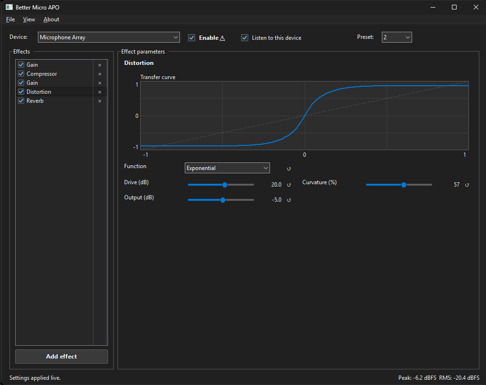

# Better Micro APO

Better Micro APO (internally `better_micro_apo`) is a simple microphone effect
for Windows. Its main goal is to raise the input level without distortion: a
peak compressor tames the peaks and makeup gain lifts the result. An optional
gate silences the input between phrases, optional noise reduction subtracts a
captured room-noise profile, and a frequency-selective dynamic processor can
tame or extend the proximity effect.



## Installation and usage

Run the GUI (it requests elevation):

```
build\bin\Release\better_micro_apo_gui.exe
```

The GUI is self-contained: the APO DLL is embedded in it, so it is the only
file you need to distribute.

The window has three tabs: **Install**, **Devices**, and **Effects**. Later
tabs stay disabled until their prerequisite is met, and the app opens on the
most advanced tab that is available.

### Install

1. Click **Install** to extract the embedded APO DLL to
   `C:\Program Files\better_micro_apo`, register its COM class, and restart
   audio. Audio stops for about a second. If the installed DLL is older than
   the GUI, the DLL row shows **outdated** and the button becomes **Update**;
   click it to replace the DLL with the embedded copy.
2. Click **Uninstall** to unbind the devices, unregister the APO, and remove the
   installed DLL directory. Backups, settings, and logs stay in
   `C:\ProgramData\better_micro_apo`.

### Devices

1. Check the capture devices to enable the effect on. Inactive devices are
   shown grayed out.
2. On a device that uses an effect pack, **Ignore other effects** leaves only
   this APO: it drops the driver's endpoint chain and its other composite
   chains (stream, mode, keyword detector, offload), so none of the pack's
   processing runs. This is per device and is applied with **Apply**; unchecking
   it restores the driver chains from the backup.
3. Click **Apply** to save the bindings and isolation options. Audio stops for
   about a second. Every device is bound as an **endpoint effect**, which is
   also what makes the processing apply to apps that capture raw audio, such as
   Discord and WhatsApp; stream-slot bindings are skipped for those streams. If
   a device is still bound by an older build, the view shows **Apply to finish
   the update** until the migration runs. **Reset** discards pending device
   changes.

### Effects

1. Choose a bound device from the list at the top. Each capture device keeps its
   own settings. If a mono source is plugged into the left input of a stereo
   device, enable **Mono** so both sides carry it. This affects every app that
   uses the device.
2. The list on the left shows the effects for this device in processing order.
   Use the checkboxes to enable or disable an effect, click a row to edit its
   parameters on the right, and click the `×` in a row to delete it. **Add
   effect** opens a picker and appends the chosen type to the end of the list.
   The same type may appear more than once, and the list order is the DSP order.
   Adding or deleting an effect applies live without stopping audio. A deleted
   effect loses its values: adding that type again starts from its defaults.
   A device can hold up to 16 effects; noise reduction, gate, and reverb are
   limited to 4 each because they allocate large buffers.
3. To reduce steady room noise, select **Noise reduction**, keep the room quiet,
   and click **Capture noise profile**. The GUI records about three seconds,
   analyzes the noise spectrum, and saves it for that device. Capturing stops
   audio briefly, temporarily disables every stage so the profile is raw, and
   turns **Noise reduction** on when it finishes. **Reduction** caps how much
   any frequency is attenuated.
4. Check **Listen to this device** to hear the selected device through the
   default output. This is the quickest way to audition the applied settings.
   Use headphones to avoid feedback from speakers. Listening stops on its own
   when you change the selection, install, or uninstall, and it restarts after
   an operation that has to restart audio. Settings-only applies leave it
   running. While listening, **Peak** is the
   maximum level over the last 500 ms and **RMS** is the average level over the
   same window, both measured after the APO. **CLIP** latches when the peak
   reaches full scale, and **drops** counts gaps in the monitor stream.
5. Effect settings apply automatically while you drag and shortly after you
   stop editing; no **Apply** click is needed. The running APO picks them up
   without stopping audio. The first change on a device that has not published
   live settings yet, or after the APO DLL was updated, may restart audio once.
   **Reset** discards pending effect edits. While an effect edit is pending, the
   device selector is locked and **Apply** is highlighted.

**Open log** opens `C:\ProgramData\better_micro_apo\better_micro_apo.log`.

## Build

```powershell
cmake -S . -B build -G "Visual Studio 17 2022" -A x64
cmake --build build --config Release
```

Output:

```
build\bin\Release\better_micro_apo.dll
build\bin\Release\better_micro_apo_gui.exe
```

`better_micro_apo_gui.exe` is the distributable: CMake embeds the DLL into it
as an `RCDATA` resource during the build, so it can be shipped on its own. The
standalone DLL is still produced for debugging.

The DLL uses the static MSVC runtime and has no third-party dependencies.

## DSP settings

The effect list is built per device and processed from top to bottom. The same
type may appear more than once, so two gates or two reverbs are allowed. New
installations start with the original chain:

```
optional noise reduction -> optional gate -> optional dynamic (proximity) ->
peak compressor -> optional makeup gain -> optional mono copy ->
optional distortion -> optional reverb
```

Delete and re-add an effect to move it to the end of the list; drag-and-drop is
not implemented yet. Every newly added effect starts enabled.

- **Noise reduction** subtracts the captured room-noise spectrum from the input.
  In the default chain it runs first, before the gate and compressor, so it sees
  the raw signal. The profile is captured per device with **Capture noise
  profile**: the GUI records about three seconds while every effect is
  temporarily off, then stores the analyzed spectrum next to the device
  settings. **Reduction** limits how much any frequency can be attenuated. A
  profile is required; without one the effect is skipped. It is off by default.
- **Gate** attenuates the signal when it falls below the threshold. `Range` is
  the maximum attenuation while closed, and `Hold` keeps it open after the level
  drops. `Lookahead` delays the audio so the gate opens before a transient
  arrives; it adds that much latency while the gate is enabled. The gate is off
  by default.
- **Compressor** uses a linked peak detector, so a stereo source keeps its
  image.
- **Dynamic** is a frequency-selective compressor/expander aimed at the
  proximity effect. `Frequency` and `Q` choose the band; a broad Q behaves like
  a dynamic low shelf. In the default reduce mode it cuts the band when it is
  loud, taming a strong proximity effect up close. Check **Extend quiet lows**
  to do the opposite: lift the band when it is quiet, making distant or thin
  lows fuller. `Threshold`, `Ratio`, `Range`, `Attack`, and `Release` control
  how much and how fast. In the default chain it runs before the broadband
  compressor so it sees the input dynamics. It is off by default.
- **Gain** applies flat gain. In the default chain it is the makeup gain after
  the compressor. A newly added Gain starts at 0 dB.
- **Mono (left to all channels)** duplicates the processed left channel to all
  other channels. It is per device and is saved with the other settings.
- **Distortion** adds soft saturation. Choose a curve from the **Function**
  list: `Tanh`, `Arctan`, `Cubic polynomial`, `Logarithmic`, `Exponential`, or
  `Error function`. **Drive** sets the level into the curve, **Curvature**
  bends it from nearly linear to fully saturated, and **Output** sets the level
  after it. Every curve is symmetric and maps full scale to full scale. In the
  default chain it runs before reverb so the tail stays clean. It is off by
  default.
- **Reverb** adds a room or hall tail. `Mix` sets the dry/wet balance, `Size`
  moves from a small room to a long hall, `Damping` controls how quickly the
  highs fade, and `Predelay` leaves a gap before the tail starts. In the default
  chain it runs last, after mono, so a mono microphone still gets a wide stereo
  tail. It is off by default.

Default settings (the initial list; a new Gain starts at 0 dB instead):

| Noise reduction | Reduction |
| --- | --- |
| off | 12 dB |

| Gate | Threshold | Range | Attack | Hold | Release | Lookahead |
| --- | --- | --- | --- | --- | --- | --- |
| off | -50 dBFS | 60 dB | 5 ms | 50 ms | 100 ms | 0 ms |

| Compressor | Threshold | Ratio | Attack | Release |
| --- | --- | --- | --- | --- |
| enabled | -58 dBFS | 3:1 | 5 ms | 100 ms |

| Gain | Gain |
| --- | --- |
| enabled | +28 dB |

| Dynamic | Mode | Frequency | Q | Threshold | Ratio | Range | Attack | Release |
| --- | --- | --- | --- | --- | --- | --- | --- | --- |
| off | reduce | 120 Hz | 0.7 | -45 dBFS | 4:1 | 18 dB | 10 ms | 150 ms |

| Distortion | Function | Drive | Curvature | Output |
| --- | --- | --- | --- | --- |
| off | Tanh | 0 dB | 50% | 0 dB |

| Reverb | Mix | Size | Damping | Predelay |
| --- | --- | --- | --- | --- |
| off | 20% | 50% | 50% | 20 ms |

Each capture device stores its own settings in
`C:\ProgramData\better_micro_apo\devices\{endpoint-guid}.ini`. The file has a
`[dsp]` section with `version=2`, `effect_count`, `next_effect_id`, and one
`effect_<n>_*` block per list entry, so duplicates and their order survive a
restart. Older files are migrated automatically and keep the original chain. The
APO reads the file when a stream starts, so one DLL serves every device.
**Listen to this device** (Effects tab) opens a new stream and plays the saved
settings; edits are saved live, so the audition follows them.

Older settings files that contain the removed `input_gain_db` key are migrated
automatically: the value is folded into the compressor threshold and makeup
gain, so the sound stays the same.

The GUI clamps values to a safe range:

| Setting | Range |
| --- | --- |
| Noise reduction | 0 to 70 dB |
| Gate threshold | -80 to 0 dBFS |
| Gate range | 0 to 96 dB |
| Gate attack | 0.1 to 1000 ms |
| Gate hold | 0 to 2000 ms |
| Gate release | 1 to 5000 ms |
| Gate lookahead | 0 to 300 ms |
| Compressor threshold | -60 to 0 dBFS |
| Compressor ratio | 1:1 to 20:1 |
| Compressor attack | 0.1 to 1000 ms |
| Compressor release | 1 to 5000 ms |
| Dynamic frequency | 20 to 2000 Hz |
| Dynamic Q | 0.1 to 10 |
| Dynamic threshold | -80 to 0 dBFS |
| Dynamic ratio | 1:1 to 20:1 |
| Dynamic range | 0 to 36 dB |
| Dynamic attack | 0.1 to 1000 ms |
| Dynamic release | 1 to 5000 ms |
| Gain | -24 to +48 dB |
| Distortion function | Tanh, Arctan, Cubic polynomial, Logarithmic, Exponential, or Error function |
| Distortion drive | 0 to 36 dB |
| Distortion curvature | 0 to 100% |
| Distortion output | -24 to +12 dB |
| Reverb mix | 0 to 100% |
| Reverb size | 0 to 100% |
| Reverb damping | 0 to 100% |
| Reverb predelay | 0 to 200 ms |

## Known limitations

- PCM 24-bit valid samples stored in a 32-bit container (24-in-32) are not
  supported yet.
- Effect settings apply live a moment after an edit, without stopping audio.
  Binding, isolation, install, uninstall, and noise-profile capture still
  restart the audio service briefly. The first settings change on a device that
  has no runtime file, or after the APO DLL is updated, also restarts audio
  once.
- Gate lookahead delays the stream by the configured lookahead time while the
  gate is enabled. Keep it at 0 ms if you need zero latency.
- Noise reduction delays the stream by about 512 samples while it is enabled.
  The captured profile describes the noise in the room at that moment; capture
  it again if the background noise changes noticeably.

## Architecture

See [ARCHITECTURE.md](ARCHITECTURE.md) for implementation details and a general
guide to installing custom APOs.
