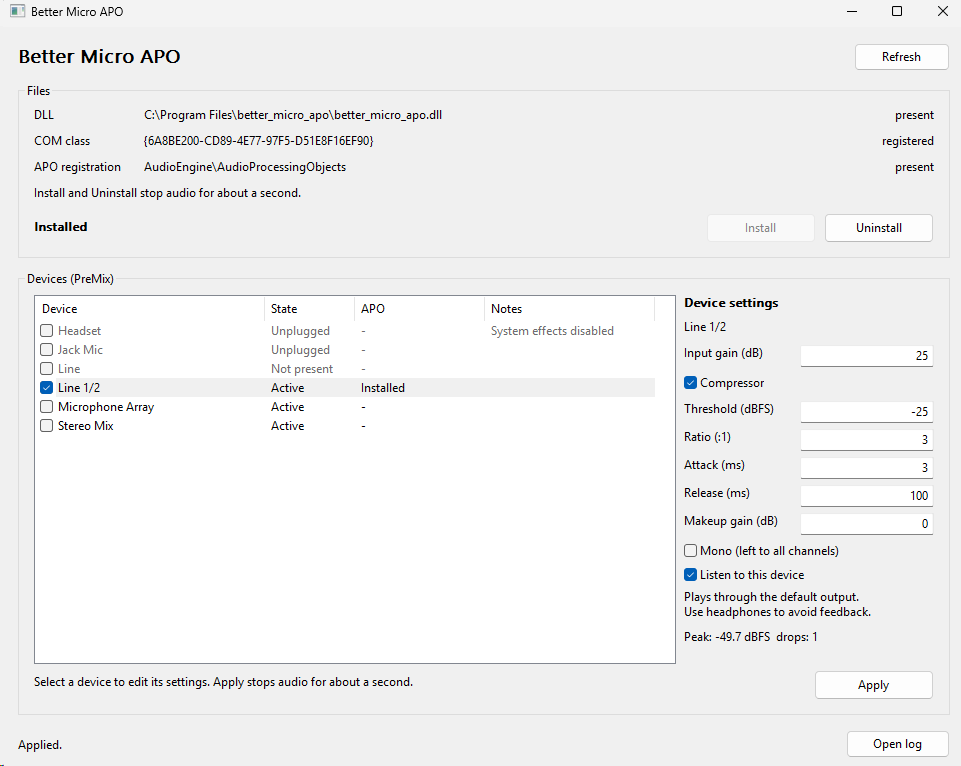

# Better Micro APO

Better Micro APO (internally `better_micro_apo`) is a simple microphone effect
for Windows. Its main goal is to raise the input level without distortion:
input gain lifts the signal, while a peak compressor tames the peaks.



## Installation and usage

Run the GUI (it requests elevation):

```
build\bin\Release\better_micro_apo_gui.exe
```

The GUI is self-contained: the APO DLL is embedded in it, so it is the only
file you need to distribute.

1. Click **Install** to extract the embedded APO DLL to
   `C:\Program Files\better_micro_apo`, register its COM class, and restart
   audio. Audio stops for about a second.
2. Check the capture devices to enable the effect on. Inactive devices are
   shown grayed out.
3. Select a device and edit its settings in the panel on the right. Each
   capture device keeps its own settings. If a mono source is plugged into the
   left input of a stereo device, check **Mono (left to all channels)** so both
   sides carry it. This affects every app that uses the device.
4. Click **Apply** to save the settings and bind the selected devices to the
   PreMix slot. Audio stops for about a second.
5. Check **Listen to this device** to hear the selected device through the
   default output. This is the quickest way to audition the applied settings.
   Use headphones to avoid feedback from speakers. Listening stops on its own
   when you change the selection, apply, install, or uninstall. While
   listening, **Peak** shows the level of the monitored stream after the APO;
   **CLIP** latches when it reaches full scale, and **drops** counts gaps in
   the monitor stream.
6. Click **Uninstall** to unbind the devices, unregister the APO, and remove the
   installed DLL directory. Backups, settings, and logs stay in
   `C:\ProgramData\better_micro_apo`.

The GUI currently binds only the PreMix slot. **Open log** opens
`C:\ProgramData\better_micro_apo\better_micro_apo.log`.

## Build

```powershell
cmake -S . -B build -G "Visual Studio 17 2022" -A x64
cmake --build build --config Release
```

Output:

```
build\bin\Release\better_micro_apo.dll
build\bin\Release\better_micro_apo_gui.exe
```

`better_micro_apo_gui.exe` is the distributable: CMake embeds the DLL into it
as an `RCDATA` resource during the build, so it can be shipped on its own. The
standalone DLL is still produced for debugging.

The DLL uses the static MSVC runtime and has no third-party dependencies.

## Releases

GitHub Actions builds the Release configuration on every push and publishes a
release for every `v*` tag. The release contains
`better_micro_apo-<tag>-win64.zip` with the GUI executable and these docs.

To publish a release:

```powershell
git tag v0.1.0
git push origin v0.1.0
```

## DSP settings

The chain is fixed:

```
input gain -> peak compressor -> makeup gain -> optional mono copy
```

The optional mono copy duplicates the processed left channel to all other
channels. It is per device and is saved with the other settings.

Default settings:

| Input gain | Compressor | Threshold | Ratio | Attack | Release | Makeup gain |
| --- | --- | --- | --- | --- | --- | --- |
| +28 dB | enabled | -30 dBFS | 3:1 | 5 ms | 100 ms | 0 dB |

Each capture device stores its own settings in
`C:\ProgramData\better_micro_apo\devices\{endpoint-guid}.ini`. The APO reads
that file when a stream starts, so one DLL serves every device. **Listen to
this device** opens a new stream and therefore plays the saved settings; click
**Apply** first to hear unsaved edits.

The GUI clamps values to a safe range: input and makeup gain -24 to +48 dB,
threshold -60 to 0 dBFS, ratio 1:1 to 20:1, attack 0.1 to 1000 ms, and release
1 to 5000 ms.

## Known limitations

- PCM 24-bit valid samples stored in a 32-bit container (24-in-32) are not
  supported yet.
- Settings take effect after **Apply**, which briefly stops audio. Changing
  them while audio keeps running is not supported yet.

## Architecture

See [ARCHITECTURE.md](ARCHITECTURE.md) for implementation details and a general
guide to installing custom APOs.
